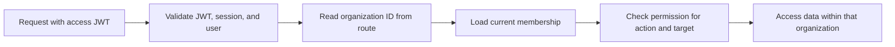

# Simple multi-tenant authentication and authorization

Status: registration and CSRF HTTP endpoints, registration rate limiting, the registration service and input policy, UUIDv7 generation, password hashing, and user persistence are implemented. Login, refresh, logout, and tenant-management APIs remain planned. See the [registration API walkthrough](registration-api.md) for local usage.

Authentication uses a planned combination of access JWTs, application-owned sessions, and rotating refresh tokens. Their [domain models](data-and-domain-model.md#authsession--one-login) are defined. The implemented CSRF cookie does not represent a login session; Spring Security does not persist authentication in servlet `HttpSession`.

Build a backend that lets users register, sign in, belong to multiple tenants, and perform actions according to their role in each tenant. The application has no selected business domain. This document uses **organization** as the name for a tenant.

The existing project uses Java 21, Spring Boot, Spring Security, Spring Data JPA, Flyway, and PostgreSQL.

## 1. First version

Implement:

- Registration, login, current-user lookup, and logout.
- Organization creation and listing the organizations a user belongs to.
- Adding registered users to organizations, changing roles, and removing memberships.
- Tenant isolation and three fixed roles: `OWNER`, `ADMIN`, and `MEMBER`.
- Tests demonstrating both allowed and denied access.

Use one backend and one PostgreSQL database with a shared schema. Access JWTs will identify users and their application-owned login sessions; browser refresh credentials will use cookies. Curl or Postman can retain cookies and send headers, so a frontend is optional.

Keep email invitations, email verification, password recovery, MFA, social login, custom roles, and audit dashboards as optional extensions. The first version is a local learning project.

## 2. Identity, tenant, and role

| Concept | Meaning | Example |
| --- | --- | --- |
| User | A global account that can log in | Alice |
| Organization | A tenant and its access boundary | Organization A |
| Membership | A user's association with an organization | Alice belongs to Organization A |
| Role | Permissions granted through that membership | Alice is its owner |

**Authentication** identifies the user. **Authorization** checks whether that user may perform an action in the requested organization.

Alice can be an `OWNER` in Organization A and a `MEMBER` in Organization B. Logging in identifies Alice; it does not give her owner access everywhere. Roles belong on memberships, not on the user record.

## 3. Minimal data model

Three application tables currently exist. `AuthSession` and `RefreshToken` domain classes are defined; their database tables and repositories are a subsequent step.

| Entity | Fields | Constraints |
| --- | --- | --- |
| `User` | `id`, `email`, `passwordHash`, `status`, `createdAt`, `updatedAt` | Unique canonical email; status is `ACTIVE` or `DISABLED` |
| `Organization` | `id`, `name`, `createdAt`, `updatedAt` | Names do not grant access or establish identity |
| `Membership` | `id`, `organizationId`, `userId`, `role`, `status`, `createdAt`, `updatedAt` | Unique `(organizationId, userId)`; status is `ACTIVE` or `REMOVED` |

Use UUIDv7 IDs, UTC timestamps, foreign keys to users and organizations, and database constraints for valid roles and statuses. UUIDs do not replace permission checks.

The [data and domain model specification](data-and-domain-model.md) defines the Java models, implemented persistence, and initial PostgreSQL migration. Registration is implemented; login/session and tenancy services remain planned work.

For this application, canonicalize email by trimming surrounding whitespace and lowercasing with a locale-independent rule, then enforce a maximum of 254 Unicode code points. Organization names are trimmed and limited to 200 Unicode code points. Do not strip dots or `+` suffixes from email. Never transform or silently truncate a password.

A user starts with no memberships. Creating an organization gives that user its owner membership. Removing a membership preserves its row; adding that person again reactivates it with the newly authorized role.

Permissions are a fixed mapping in application code for this version. Separate role and permission tables are unnecessary until custom roles become a requirement.

## 4. Authentication

### Registration and passwords

The implemented entry point is `RegisterService.register(email, rawPassword)`, returning the created user's UUID. `RegistrationPolicy` canonicalizes and validates email with Jakarta Bean Validation's `@Email`, checks the current 10–128 code-point password limit, and checks a case-insensitive local blocklist. Password hashing receives the original input, including spaces and case. The blocklist at `src/main/resources/security/common-passwords.txt` is a small starter list for this learning project, not a comprehensive breach corpus. Email validation checks syntax; it does not verify mailbox ownership.

The service uses `IdGenerator`, `PasswordHasher`, `UserRepository`, and an injected UTC `Clock`. Infrastructure supplies UUIDv7 through Java UUID Generator and salted Argon2id hashes through Spring Security. Stored hashes carry the `{argon2}` encoder identifier and the Argon2 parameters and salt. The configured costs are 19 MiB memory, 2 iterations, and parallelism 1. [Java UUID Generator](https://github.com/cowtowncoder/java-uuid-generator)

An initial email lookup provides an early duplicate result. The insert-only `UserRepository.create` operation uses `persist` and `flush` in a write transaction, with the database's `uq_users_email` constraint resolving concurrent registrations. Both duplicate paths raise `EmailAlreadyExistsException`. Other database errors propagate separately. Password hashing runs before the write transaction starts. Registration creates neither memberships nor an authenticated session.

`AuthController` exposes `POST /api/auth/register`. A dedicated request DTO accepts credentials and redacts them in `toString()`; a separate response DTO contains only `userId`. Bean Validation checks required fields, while the service's policy handles normalization, email syntax, and password rules. `GlobalExceptionHandler` translates invalid registration input to `400`, duplicates to `409`, and unexpected failures to a generic `500` without returning exception details or rejected values.

Registration accepts `{email, password}` as JSON strings and creates an active user with no organization or role. Unknown fields such as `role`, `organizationId`, or `status`, duplicate keys, trailing JSON values, and numeric/boolean credentials are rejected. Other content types return `415` after security checks pass.

Return `201` on creation and `409 EMAIL_ALREADY_EXISTS` for a duplicate canonical email. This simple contract reveals whether an address is registered; a later public signup flow can use generic responses and email verification. Never overwrite an existing user's credentials.

Email is only a login identifier in this version. Without verification, it is not evidence of mailbox ownership. Assign memberships using a registered user's ID; do not automatically join organizations based on email or email domain.

The current project password policy accepts 10–128 Unicode code points, including spaces, without mandatory character combinations. It uses a local common-password blocklist. Hashes use Spring Security's `PasswordEncoder`, configured for Argon2id with 19 MiB memory, 2 iterations, and parallelism 1, with Bouncy Castle providing the required implementation. See [OWASP Password Storage](https://cheatsheetseries.owasp.org/cheatsheets/Password_Storage_Cheat_Sheet.html) and [Spring password storage](https://docs.spring.io/spring-security/reference/features/authentication/password-storage.html).

### Login, sessions, refresh, and logout — planned

1. Login accepts `{email, password}` and checks credentials and current account status.
2. Return the same `401 Invalid credentials` for an unknown user, incorrect password, or disabled account. Perform a dummy hash comparison for unknown users to avoid an obvious timing difference.
3. On success, create a new `AuthSession`, store a refresh-token hash, issue a five-minute access JWT, and set the refresh-token cookie. Access-token claims include `sub`, `sid`, `iss`, `aud`, `iat`, and `exp`.
4. Validate the JWT and check that its session belongs to its user, is active, and has not expired. Check current account status and load current tenant memberships for authorization; roles remain specific to the requested organization.
5. Use 30 minutes idle expiry and a 12-hour absolute session lifetime. Accepted activity cannot extend the absolute deadline.
6. Refresh atomically consumes the old refresh token and inserts its replacement. Reuse of a consumed token revokes the session, and that revocation must commit before returning an error.
7. Logout revokes the current session and expires its refresh cookie. Subsequent protected requests fail their session check even when the access JWT has not expired.

Use a host-only refresh cookie with `HttpOnly`, `Secure`, and `SameSite=Lax`. Access JWTs are sent in the `Authorization: Bearer` header. Refresh-token generation, JWT signing and validation, session persistence, and these endpoints are not yet implemented. Form login, HTTP Basic, and Spring's default logout endpoint are disabled.

Planned login throttling: 5 failed attempts per identifier and 30 per IP in 15 minutes, counting unknown identifiers too. Implemented registration throttling: 10 requests per connection IP in a fixed one-hour window, counted after CSRF succeeds and before JSON binding. Responses use `429 RATE_LIMITED` with `Retry-After`. Configure `app.security.registration.max-attempts` and `app.security.registration.window-seconds`. The limiter is in memory, resets on restart, and bounds tracked clients at 10,000; a new client is temporarily rejected if that capacity is full. It does not read caller-supplied forwarded-IP headers. These are project choices; multiple backend instances would need shared limits.

### CSRF

CSRF protection is enabled. `GET /api/auth/csrf` returns `{headerName, token}` and sets a host-only `XSRF-TOKEN` cookie with `HttpOnly`, `SameSite=Lax`, and `Path=/`. The cookie is `Secure` by default; the explicit `local` profile disables `Secure` for localhost HTTP. Spring's cookie CSRF repository and default XOR request handler are used. Retain the cookie and send the token from the JSON response in the returned `X-CSRF-TOKEN` header; the cookie value itself is not the masked response token. Invalid or missing CSRF returns `403 CSRF_INVALID`. Future login and logout flows must rotate CSRF state and clients must fetch a fresh token afterward.

Auth responses use `Cache-Control: no-store`. Start with same-origin browser access. A future frontend on another origin needs an explicit CORS allowlist with credentials; CORS does not grant tenant permissions. See [Spring CSRF protection](https://docs.spring.io/spring-security/reference/servlet/exploits/csrf.html).

## 5. Roles and membership lifecycle

Every permission below requires an active user and active membership in the requested organization.

| Action | OWNER | ADMIN | MEMBER |
| --- | --- | --- | --- |
| Read organization profile | Yes | Yes | Yes |
| Update organization name | Yes | Yes | No |
| Read own membership | Yes | Yes | Yes |
| List organization memberships | Yes | Yes | No |
| Add a registered user as `MEMBER` | Yes | Yes | No |
| Add a registered user as `ADMIN` | Yes | No | No |
| Change an existing membership's role | Yes | No | No |
| Remove a `MEMBER` | Yes | Yes | No |
| Remove an `ADMIN` or `OWNER` | Yes, subject to last-owner rule | No | No |

Any active authenticated user can create an organization and list their own organizations. An admin cannot promote themselves, create another admin, change roles, or remove owners. No role grants access to all tenants or control over another user's global account.

- **Create organization:** create the organization and the caller's owner membership in one transaction. Derive the owner from authentication.
- **Add member:** accept `{userId, role}` for an existing active user. Apply the role matrix before creating or reactivating membership. An already-active membership returns `409`; adding cannot silently change its role.
- **Promote owner:** member creation accepts only `ADMIN` or `MEMBER`. An existing owner can promote a membership to `OWNER` through the role-change endpoint.
- **Remove member:** mark it `REMOVED`. Subsequent requests lose access to this organization; login and other memberships remain valid.
- **Change role:** subsequent requests use the current role, even with a preexisting session.

For local learning, the new user obtains their ID from `/api/auth/me` and shares it with an owner or admin. Knowing an ID does not authorize member creation. No global user-directory endpoint is needed. Invitation acceptance can replace direct assignment later.

Every organization must retain at least one active owner whose user account is active. An owner may demote or remove themselves only when another active owner remains; otherwise return `409 LAST_OWNER_REQUIRED`.

Serialize membership mutations by locking the organization row in a transaction. After acquiring the lock, recheck the actor's role, target, and owner count. This also prevents an admin from removing someone who became an owner while that request was waiting.

There is no organization-deletion or global account-management API in this version. A later account-disabling operation must also preserve ownership across the user's organizations.

## 6. Tenant isolation

Use routes such as `/api/organizations/{organizationId}/memberships`. The route selects the requested tenant; it is untrusted input, not proof of access.

For every tenant request:

1. Authenticate the user and check account status.
2. Load active membership using both `organizationId` and authenticated `userId`.
3. Check whether the actor's role permits the operation.
4. Load the target using both its ID and the requested organization ID.
5. Check target-specific restrictions, such as whether an admin may remove that member's role.
6. For writes, repeat relevant checks inside the transaction.

Scope membership queries, for example `findByOrganizationIdAndId(...)`. Lists and counts must use the same organization filter. A membership ID from B must not work inside an A URL, even when the caller belongs to both.

Derive the organization from the validated route. Only member creation accepts a target `userId`; only authorized member creation and role changes accept a role. Reject unknown or server-controlled input fields. Each tenant route carries its organization ID; the session has no mutable global active tenant.

Keep permission checks in an `OrganizationAccessService` or `AuthorizationPolicy`, enforced by application services. `SecurityFilterChain` handles authentication and CSRF. A global `hasRole('OWNER')` check alone cannot establish tenant access. If using `@PreAuthorize`, enable method security explicitly and account for proxy self-invocation limitations. See [OWASP Authorization](https://cheatsheetseries.owasp.org/cheatsheets/Authorization_Cheat_Sheet.html), [OWASP Multi-Tenant Security](https://cheatsheetseries.owasp.org/cheatsheets/Multi_Tenant_Security_Cheat_Sheet.html), and [Spring method security](https://docs.spring.io/spring-security/reference/servlet/authorization/method-security.html).

## 7. API contracts

The CSRF and registration endpoints are implemented. All other endpoints below are planned. Only `GET /api/auth/csrf` and `POST /api/auth/register` currently allow anonymous requests. Other routes require authentication, which will be implemented in the login/JWT step. Public unsafe methods still require CSRF. Roles below always mean roles in the requested organization.

| Method and path | Access | Input / success result |
| --- | --- | --- |
| `GET /api/auth/csrf` | Public | `200 {headerName, token}`; cookie as needed |
| `POST /api/auth/register` | Public | `{email, password}` → `201 {userId}` |
| `POST /api/auth/login` | Public | `{email, password}` → `200 {accessToken, tokenType, expiresIn}` and refresh cookie |
| `POST /api/auth/refresh` | Valid refresh cookie, with CSRF | `200 {accessToken, tokenType, expiresIn}` and replacement refresh cookie |
| `GET /api/auth/me` | Authenticated | `200 {userId, email}` |
| `POST /api/auth/logout` | Public, with CSRF | Invalidate current session if present → `204` |
| `POST /api/organizations` | Authenticated | `{name}` → `201` organization and owner membership |
| `GET /api/organizations` | Authenticated | `200` caller's active organizations and roles |
| `GET /api/organizations/{orgId}` | Any active member | `200` profile |
| `PATCH /api/organizations/{orgId}` | Owner or admin | `{name}` → `200` profile |
| `GET /api/organizations/{orgId}/memberships/me` | Any active member | `200` own membership |
| `GET /api/organizations/{orgId}/memberships` | Owner or admin | `200` membership list |
| `POST /api/organizations/{orgId}/memberships` | Owner or admin, role restrictions apply | `{userId, role}` → `201` created or reactivated membership |
| `PATCH /api/organizations/{orgId}/memberships/{id}/role` | Owner | `{role}` → `200` membership |
| `DELETE /api/organizations/{orgId}/memberships/{id}` | Owner, or admin removing a member | Mark removed → `204` |

Membership responses contain `id`, `organizationId`, `userId`, `role`, and `status`. Lists are paginated: page 0 and size 20 by default, maximum size 100, stable ordering. Never return password hashes or session details. Member lists omit email addresses and memberships in other tenants.

| Status | Use |
| --- | --- |
| `400` | Invalid input, unsupported role, or unrecognized fields |
| `401` | Invalid credentials or missing/expired authentication |
| `403` | Tenant member lacks permission; also missing/invalid CSRF |
| `404` | Organization inaccessible, resource outside requested tenant, or target user unavailable for member creation |
| `409` | Duplicate registration, already-active membership, or last-owner conflict |
| `429` | Throttled request, with `Retry-After` |

Use consistent `{code, message}` errors. Nonmembers receive the same `404` whether an organization exists or not. After establishing membership, check operation permission before mutation and scope target lookup to that organization. Missing authentication normally returns `401`, but a CSRF rejection can occur first and return `403`.

## 8. Acceptance tests

Use organizations A and B. Alice owns A and is a member of B; Bob is an admin of A; Carol is a member of A; Eve belongs only to B.

| Scenario | Expected result |
| --- | --- |
| Register and log in | Password hashed; subsequent request recognizes user |
| Register duplicate canonical email | `409`; original password unchanged |
| Unknown user, wrong password, or disabled user logs in | Same `401` response shape |
| Successful login | Creates a new application-owned session and issues tokens |
| Unsafe request lacks valid CSRF | `403`; no mutation |
| Logout or reach session expiry | Subsequent protected request returns `401` |
| Create organization | Caller receives owner membership atomically |
| Alice tries to manage B members | `403`; her A role does not apply |
| Eve requests A | `404`; no tenant information leaked |
| Use B membership ID in A route | `404`; no read or change |
| Bob adds or removes an ordinary member | Allowed |
| Bob adds an admin, changes a role, or removes an owner | `403` |
| Register with a supplied role or tenant ID | `400`; no privilege granted |
| List organizations or memberships | Only permitted data and counts appear |
| Demote or remove a member with an existing session | Next request reflects current membership |
| Remove or demote the last owner | `409`; an active owner remains |
| Two owners concurrently remove each other | At least one active owner remains |
| Concurrent member promotion and admin removal | Serialized checks prevent admin removal of an owner |

Use policy unit tests, Spring Security integration tests for JWTs/CSRF, and PostgreSQL integration tests for scoping, constraints, and concurrency. These are planned acceptance criteria, not existing coverage. New automated tests remain deferred at the user's request.

## 9. Implementation order

1. Completed: the three initial tables, registration service and HTTP API, password hashing, CSRF endpoint, and registration throttling.
2. Next: session and refresh-token persistence, followed by login, `/auth/me`, refresh, logout, JWT validation, and login throttling.
3. Implement organization creation and membership-aware listing.
4. Implement the role matrix, member management, and last-owner checks.
5. Run the authentication, tenant-isolation, and permission tests above.

The first version is complete when a user can log in, belong to multiple organizations with different roles, and access only the operations and tenant data permitted by current memberships.
