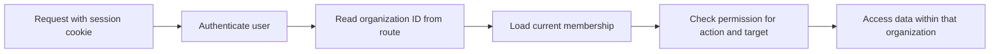

# Simple multi-tenant authentication and authorization

Status: proposed design. The APIs and security controls below are not implemented yet.

Build a backend that lets users register, sign in, belong to multiple tenants, and perform actions according to their role in each tenant. The application has no selected business domain. This document uses **organization** as the name for a tenant.

The existing project uses Java 21, Spring Boot, Spring Security, Spring Data JPA, Flyway, and PostgreSQL.

## 1. First version

Implement:

- Registration, login, current-user lookup, and logout.
- Organization creation and listing the organizations a user belongs to.
- Adding registered users to organizations, changing roles, and removing memberships.
- Tenant isolation and three fixed roles: `OWNER`, `ADMIN`, and `MEMBER`.
- Tests demonstrating both allowed and denied access.

Use one backend and one PostgreSQL database with a shared schema. Start with server-side sessions and cookies; curl or Postman can retain the cookie, so a frontend is optional. Sessions are a proposed starting choice; JWT is an optional later alternative.

Keep email invitations, email verification, password recovery, MFA, social login, custom roles, and audit dashboards as optional extensions. The first version is a local learning project.

## 2. Identity, tenant, and role

| Concept | Meaning | Example |
| --- | --- | --- |
| User | A global account that can log in | Alice |
| Organization | A tenant and its access boundary | Organization A |
| Membership | A user's association with an organization | Alice belongs to Organization A |
| Role | Permissions granted through that membership | Alice is its owner |

**Authentication** identifies the user. **Authorization** checks whether that user may perform an action in the requested organization.

Alice can be an `OWNER` in Organization A and a `MEMBER` in Organization B. Logging in identifies Alice; it does not give her owner access everywhere. Roles belong on memberships, not on the user record.

## 3. Minimal data model

Use three application tables. Sessions initially live in application memory.

| Entity | Fields | Constraints |
| --- | --- | --- |
| `User` | `id`, `email`, `passwordHash`, `status`, `createdAt`, `updatedAt` | Unique canonical email; status is `ACTIVE` or `DISABLED` |
| `Organization` | `id`, `name`, `createdAt`, `updatedAt` | Names do not grant access or establish identity |
| `Membership` | `id`, `organizationId`, `userId`, `role`, `status`, `createdAt`, `updatedAt` | Unique `(organizationId, userId)`; status is `ACTIVE` or `REMOVED` |

Use UUIDv7 IDs, UTC timestamps, foreign keys to users and organizations, and database constraints for valid roles and statuses. UUIDs do not replace permission checks.

The [data and domain model specification](data-and-domain-model.md) defines the Java models, JPA mappings, relationships, and initial PostgreSQL migration. Services and API contracts below remain planned work.

For this application, canonicalize email by trimming surrounding whitespace and lowercasing with a locale-independent rule, then enforce a maximum of 254 Unicode code points. Organization names are trimmed and limited to 200 Unicode code points. Do not strip dots or `+` suffixes from email. Never transform or silently truncate a password.

A user starts with no memberships. Creating an organization gives that user its owner membership. Removing a membership preserves its row; adding that person again reactivates it with the newly authorized role.

Permissions are a fixed mapping in application code for this version. Separate role and permission tables are unnecessary until custom roles become a requirement.

## 4. Authentication

### Registration and passwords

Registration accepts `{email, password}` and creates an active user with no organization or role. Reject fields such as `role`, `organizationId`, or `status`.

Return `201` on creation and `409 EMAIL_ALREADY_EXISTS` for a duplicate canonical email. This simple contract reveals whether an address is registered; a later public signup flow can use generic responses and email verification. Never overwrite an existing user's credentials.

Email is only a login identifier in this version. Without verification, it is not evidence of mailbox ownership. Assign memberships using a registered user's ID; do not automatically join organizations based on email or email domain.

Accept passwords of 15–128 Unicode code points, including spaces, without mandatory character combinations. Use a local common-password blocklist. Store hashes through Spring Security's `PasswordEncoder`, configured for Argon2id with at least 19 MiB memory, 2 iterations, and parallelism 1. Include the encoder's required crypto provider. Never store plaintext passwords. See [OWASP Authentication](https://cheatsheetseries.owasp.org/cheatsheets/Authentication_Cheat_Sheet.html), [OWASP Password Storage](https://cheatsheetseries.owasp.org/cheatsheets/Password_Storage_Cheat_Sheet.html), and [Spring password storage](https://docs.spring.io/spring-security/reference/features/authentication/password-storage.html).

### Login, sessions, and logout

1. Login accepts `{email, password}` and checks credentials and current account status.
2. Return the same `401 Invalid credentials` for an unknown user, incorrect password, or disabled account. Perform a dummy hash comparison for unknown users to avoid an obvious timing difference.
3. On success, rotate the session ID and save authentication. A custom JSON login must integrate `AuthenticationManager`, `SessionAuthenticationStrategy`, and `SecurityContextRepository`.
4. Store user identity and authentication time in the session. Load current tenant memberships when authorizing requests; do not store tenant roles as global authorities.
5. Check current user status on authenticated requests. Configure 30 minutes idle expiry and explicitly enforce a 12-hour absolute session lifetime.
6. Logout invalidates the current session and expires its cookie. Restarting the initial single-instance backend also ends in-memory sessions.

Use a host-only `JSESSIONID` cookie with `HttpOnly`, `Secure`, `SameSite=Lax`, and `Path=/`. A localhost-only HTTP profile can disable `Secure`. Return JSON errors instead of login-page redirects. See [Spring session management](https://docs.spring.io/spring-security/reference/servlet/authentication/session-management.html).

Throttle login by account identifier and source IP. Initial configurable limits: 5 failed attempts per identifier and 30 per IP in 15 minutes; return `429` with `Retry-After`. Count unknown identifiers too. Limit registration to 10 attempts per IP per hour. These are project choices, not framework defaults.

### CSRF

Keep CSRF protection enabled for cookie authentication, including registration, login, and logout. `GET /api/auth/csrf` returns `{headerName, token}` from Spring's session-backed CSRF support. Retain the cookie and send the token in the returned header on POST, PATCH, PUT, and DELETE requests. Fetch a fresh token after login and logout.

Auth responses use `Cache-Control: no-store`. Start with same-origin browser access. A future frontend on another origin needs an explicit CORS allowlist with credentials; CORS does not grant tenant permissions. See [Spring CSRF protection](https://docs.spring.io/spring-security/reference/servlet/exploits/csrf.html).

## 5. Roles and membership lifecycle

Every permission below requires an active user and active membership in the requested organization.

| Action | OWNER | ADMIN | MEMBER |
| --- | --- | --- | --- |
| Read organization profile | Yes | Yes | Yes |
| Update organization name | Yes | Yes | No |
| Read own membership | Yes | Yes | Yes |
| List organization memberships | Yes | Yes | No |
| Add a registered user as `MEMBER` | Yes | Yes | No |
| Add a registered user as `ADMIN` | Yes | No | No |
| Change an existing membership's role | Yes | No | No |
| Remove a `MEMBER` | Yes | Yes | No |
| Remove an `ADMIN` or `OWNER` | Yes, subject to last-owner rule | No | No |

Any active authenticated user can create an organization and list their own organizations. An admin cannot promote themselves, create another admin, change roles, or remove owners. No role grants access to all tenants or control over another user's global account.

- **Create organization:** create the organization and the caller's owner membership in one transaction. Derive the owner from authentication.
- **Add member:** accept `{userId, role}` for an existing active user. Apply the role matrix before creating or reactivating membership. An already-active membership returns `409`; adding cannot silently change its role.
- **Promote owner:** member creation accepts only `ADMIN` or `MEMBER`. An existing owner can promote a membership to `OWNER` through the role-change endpoint.
- **Remove member:** mark it `REMOVED`. Subsequent requests lose access to this organization; login and other memberships remain valid.
- **Change role:** subsequent requests use the current role, even with a preexisting session.

For local learning, the new user obtains their ID from `/api/auth/me` and shares it with an owner or admin. Knowing an ID does not authorize member creation. No global user-directory endpoint is needed. Invitation acceptance can replace direct assignment later.

Every organization must retain at least one active owner whose user account is active. An owner may demote or remove themselves only when another active owner remains; otherwise return `409 LAST_OWNER_REQUIRED`.

Serialize membership mutations by locking the organization row in a transaction. After acquiring the lock, recheck the actor's role, target, and owner count. This also prevents an admin from removing someone who became an owner while that request was waiting.

There is no organization-deletion or global account-management API in this version. A later account-disabling operation must also preserve ownership across the user's organizations.

## 6. Tenant isolation

Use routes such as `/api/organizations/{organizationId}/memberships`. The route selects the requested tenant; it is untrusted input, not proof of access.

For every tenant request:

1. Authenticate the user and check account status.
2. Load active membership using both `organizationId` and authenticated `userId`.
3. Check whether the actor's role permits the operation.
4. Load the target using both its ID and the requested organization ID.
5. Check target-specific restrictions, such as whether an admin may remove that member's role.
6. For writes, repeat relevant checks inside the transaction.

Scope membership queries, for example `findByOrganizationIdAndId(...)`. Lists and counts must use the same organization filter. A membership ID from B must not work inside an A URL, even when the caller belongs to both.

Derive the organization from the validated route. Only member creation accepts a target `userId`; only authorized member creation and role changes accept a role. Reject unknown or server-controlled input fields. Each tenant route carries its organization ID; the session has no mutable global active tenant.

Keep permission checks in an `OrganizationAccessService` or `AuthorizationPolicy`, enforced by application services. `SecurityFilterChain` handles authentication and CSRF. A global `hasRole('OWNER')` check alone cannot establish tenant access. If using `@PreAuthorize`, enable method security explicitly and account for proxy self-invocation limitations. See [OWASP Authorization](https://cheatsheetseries.owasp.org/cheatsheets/Authorization_Cheat_Sheet.html), [OWASP Multi-Tenant Security](https://cheatsheetseries.owasp.org/cheatsheets/Multi_Tenant_Security_Cheat_Sheet.html), and [Spring method security](https://docs.spring.io/spring-security/reference/servlet/authorization/method-security.html).

## 7. API contracts

These are planned JSON endpoints. Public endpoints require no login, but unsafe methods still require CSRF. Roles below always mean roles in the requested organization.

| Method and path | Access | Input / success result |
| --- | --- | --- |
| `GET /api/auth/csrf` | Public | `200 {headerName, token}`; cookie as needed |
| `POST /api/auth/register` | Public | `{email, password}` → `201 {userId}` |
| `POST /api/auth/login` | Public | `{email, password}` → `200 {userId, email}` and cookie |
| `GET /api/auth/me` | Authenticated | `200 {userId, email}` |
| `POST /api/auth/logout` | Public, with CSRF | Invalidate current session if present → `204` |
| `POST /api/organizations` | Authenticated | `{name}` → `201` organization and owner membership |
| `GET /api/organizations` | Authenticated | `200` caller's active organizations and roles |
| `GET /api/organizations/{orgId}` | Any active member | `200` profile |
| `PATCH /api/organizations/{orgId}` | Owner or admin | `{name}` → `200` profile |
| `GET /api/organizations/{orgId}/memberships/me` | Any active member | `200` own membership |
| `GET /api/organizations/{orgId}/memberships` | Owner or admin | `200` membership list |
| `POST /api/organizations/{orgId}/memberships` | Owner or admin, role restrictions apply | `{userId, role}` → `201` created or reactivated membership |
| `PATCH /api/organizations/{orgId}/memberships/{id}/role` | Owner | `{role}` → `200` membership |
| `DELETE /api/organizations/{orgId}/memberships/{id}` | Owner, or admin removing a member | Mark removed → `204` |

Membership responses contain `id`, `organizationId`, `userId`, `role`, and `status`. Lists are paginated: page 0 and size 20 by default, maximum size 100, stable ordering. Never return password hashes or session details. Member lists omit email addresses and memberships in other tenants.

| Status | Use |
| --- | --- |
| `400` | Invalid input, unsupported role, or unrecognized fields |
| `401` | Invalid credentials or missing/expired authentication |
| `403` | Tenant member lacks permission; also missing/invalid CSRF |
| `404` | Organization inaccessible, resource outside requested tenant, or target user unavailable for member creation |
| `409` | Duplicate registration, already-active membership, or last-owner conflict |
| `429` | Throttled request, with `Retry-After` |

Use consistent `{code, message}` errors. Nonmembers receive the same `404` whether an organization exists or not. After establishing membership, check operation permission before mutation and scope target lookup to that organization. Missing authentication normally returns `401`, but a CSRF rejection can occur first and return `403`.

## 8. Acceptance tests

Use organizations A and B. Alice owns A and is a member of B; Bob is an admin of A; Carol is a member of A; Eve belongs only to B.

| Scenario | Expected result |
| --- | --- |
| Register and log in | Password hashed; subsequent request recognizes user |
| Register duplicate canonical email | `409`; original password unchanged |
| Unknown user, wrong password, or disabled user logs in | Same `401` response shape |
| Login with preexisting anonymous session | Session ID changes |
| Unsafe request lacks valid CSRF | `403`; no mutation |
| Logout or reach session expiry | Subsequent protected request returns `401` |
| Create organization | Caller receives owner membership atomically |
| Alice tries to manage B members | `403`; her A role does not apply |
| Eve requests A | `404`; no tenant information leaked |
| Use B membership ID in A route | `404`; no read or change |
| Bob adds or removes an ordinary member | Allowed |
| Bob adds an admin, changes a role, or removes an owner | `403` |
| Register with a supplied role or tenant ID | `400`; no privilege granted |
| List organizations or memberships | Only permitted data and counts appear |
| Demote or remove a member with an existing session | Next request reflects current membership |
| Remove or demote the last owner | `409`; an active owner remains |
| Two owners concurrently remove each other | At least one active owner remains |
| Concurrent member promotion and admin removal | Serialized checks prevent admin removal of an owner |

Use policy unit tests, Spring Security integration tests for sessions/CSRF, and PostgreSQL integration tests for scoping, constraints, and concurrency. These are planned acceptance criteria, not existing coverage.

## 9. Implementation order

1. Create the three tables with Flyway; implement registration and password hashing.
2. Implement login, `/auth/me`, logout, sessions, CSRF, and throttling.
3. Implement organization creation and membership-aware listing.
4. Implement the role matrix, member management, and last-owner checks.
5. Run the authentication, tenant-isolation, and permission tests above.

The first version is complete when a user can log in, belong to multiple organizations with different roles, and access only the operations and tenant data permitted by current memberships.
