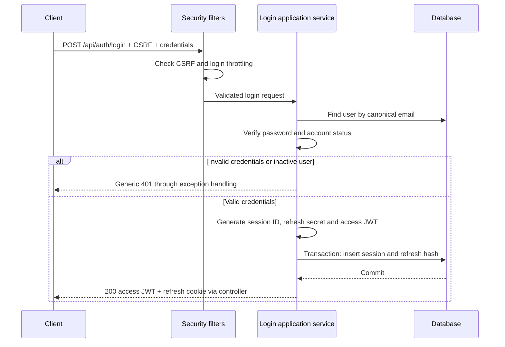
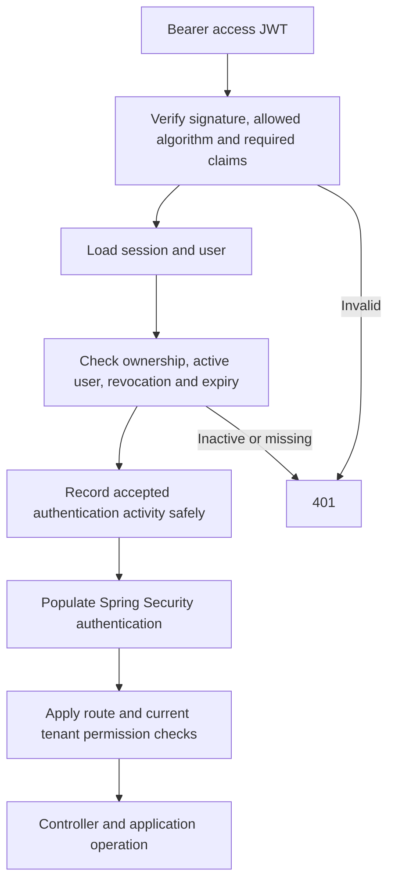

# Authentication implementation guide

Status: proposed implementation for the user to follow. Registration and CSRF already work in the code; login, JWT authentication, refresh, and logout are not complete. Domain models `AuthSession` and `RefreshToken` exist. Repository interfaces being added do not supply persistence by themselves. This guide does not add executable application code. Automated tests remain deferred at the user's request.

The [authentication specification](authentication-authorization.md) defines the API and tenant rules. This guide explains implementation decisions and request flows.

## 1. Keep the design small

Use existing domain models and configuration classes. Add classes when they have a concrete responsibility, not simply to introduce another layer.

`SessionPolicy` was proposed to group timeout values and validate them once. It is not required by Java, Spring, JWT, or the domain model. For now, use a single infrastructure `AuthProperties` record to bind and validate configuration. Do not add a second policy object carrying the same values or a shared validation helper solely for these fields.

The infrastructure configuration can pass ordinary `Duration` values into application-service constructors. Application and domain code need not import the infrastructure record. Add constructor parameters when the service needs them, rather than building speculative abstractions.

## 2. Suggested configuration code

Suggested file: `identity/infrastructure/configuration/AuthProperties.java`. This code is documentation only.

```java
package com.longdnh.donot_get_left_behind.identity.infrastructure.configuration;

import java.time.Duration;

import org.hibernate.validator.constraints.time.DurationMin;
import org.springframework.boot.context.properties.ConfigurationProperties;
import org.springframework.validation.annotation.Validated;

import jakarta.validation.constraints.AssertTrue;
import jakarta.validation.constraints.NotNull;

@Validated
@ConfigurationProperties(prefix = "app.auth")
public record AuthProperties(
        @NotNull @DurationMin(inclusive = false)
        Duration accessTokenLifetime,

        @NotNull @DurationMin(inclusive = false)
        Duration idleTimeout,

        @NotNull @DurationMin(inclusive = false)
        Duration absoluteLifetime) {

    @AssertTrue(message = "Access-token lifetime and idle timeout must not exceed absolute lifetime")
    public boolean isLifetimeOrderValid() {
        if (accessTokenLifetime == null || idleTimeout == null || absoluteLifetime == null) {
            return true; // @NotNull reports missing values separately.
        }
        return accessTokenLifetime.compareTo(absoluteLifetime) <= 0
                && idleTimeout.compareTo(absoluteLifetime) <= 0;
    }
}
```

What each part does:

- The record groups related settings and generates accessors such as `idleTimeout()`.
- `@ConfigurationProperties` binds properties under `app.auth`.
- `@Validated` enables validation during Spring Boot configuration binding.
- `@NotNull` rejects absent values.
- Hibernate Validator's `@DurationMin(inclusive = false)` requires a duration strictly greater than its default minimum of zero. This is a provider-specific annotation, not a Java language feature or a standard Jakarta duration constraint.
- `@AssertTrue` validates the boolean getter. The comparison still needs code: positivity annotations cannot compare different fields. Returning true for missing fields avoids a null-pointer failure; `@NotNull` still rejects them.

The project already declares `spring-boot-starter-validation`. No custom validator class is needed for this proposal. Configuration errors are startup diagnostics, not frontend messages.

Register the record by adding this import and annotation to the existing `IdentityConfiguration`, preserving its current methods:

```java
import org.springframework.boot.context.properties.EnableConfigurationProperties;

@Configuration(proxyBeanMethods = false)
@EnableConfigurationProperties(AuthProperties.class)
public class IdentityConfiguration {
    // Keep the existing beans here.
}
```

Suggested `application.properties` entries:

```properties
app.auth.access-token-lifetime=5m
app.auth.idle-timeout=30m
app.auth.absolute-lifetime=12h
```

Spring converts these values to `Duration`; invalid settings fail startup. This does not calculate session deadlines or issue tokens. Those operations belong in the application flows below. See [Spring Boot configuration binding and validation](https://docs.spring.io/spring-boot/reference/features/external-config.html#features.external-config.typesafe-configuration-properties.validation) and [Hibernate Validator DurationMin](https://docs.hibernate.org/stable/validator/api/org/hibernate/validator/constraints/time/DurationMin.html).

### When annotations run

Constraint annotations are metadata. Java does not automatically validate an object when `new` executes. Spring invokes validation at configured boundaries, such as `@Valid @RequestBody` and validated configuration binding; plain Java code can invoke `Validator.validate(...)` explicitly.

Standard `@Positive` is suitable for numeric values such as `long timeoutSeconds`; it is not a portable constraint for `Duration`. Keeping `Duration` avoids unit ambiguity and repeated conversions. A numeric-seconds configuration with `@Positive` is an alternative, not an additional model to implement.

Keep the existing domain checks in `AuthSession` and `RefreshToken`. They protect objects constructed outside Spring and enforce state transitions, such as refusing to revive an expired session or consume a token twice. Boundary validation and domain invariants serve different purposes.

## 3. Credentials and state

| Item | Where it lives | Purpose |
| --- | --- | --- |
| Access JWT | Returned in JSON; sent in `Authorization: Bearer` | Signed user/session identity, valid for at most five minutes |
| Application session | Database | Current login ownership, activity, expiry, revocation |
| Raw refresh credential | HttpOnly browser cookie | Secret used to obtain replacement tokens |
| Refresh credential hash | Database | Locate and verify refresh state without storing the raw secret |
| CSRF token | Existing CSRF cookie and response/header flow | Protect unsafe browser requests; does not authenticate the user |

Use UUIDv7 for database IDs. Generate refresh secrets independently using a cryptographically secure random generator; a record ID is not the credential. Store the SHA-256 hash expected by the existing `RefreshToken` model. Passwords continue using the existing slow, salted password hash.

JWT claims: `sub` is the user ID, `sid` is the session ID, `iss` identifies the issuer, `aud` identifies this API, and `iat`/`exp` define issuance and expiry. Do not put passwords or refresh credentials in JWTs. Signing does not encrypt the claims. Current tenant roles come from membership checks, not from a global role claim.

`SessionCreationPolicy.STATELESS` concerns Spring Security's servlet `HttpSession` handling. It does not prevent application-owned session rows. This design deliberately performs database checks on authenticated requests.

## 4. Login flow



1. Fetch CSRF state using the existing endpoint before the unsafe login request. Add login to the public authorization rules when its endpoint is implemented; `permitAll` does not bypass CSRF.
2. Apply login limits before expensive hashing. The specification plans five failures per identifier and thirty per IP in fifteen minutes, including unknown identifiers.
3. Normalize email consistently with registration. Preserve the password exactly. Do not apply new-registration password rules to reject otherwise valid existing credentials.
4. Use `PasswordHasher.matches`. For unknown users, compare against a precomputed dummy hash with equivalent cost. Unknown user, wrong password, and disabled account receive the same client error; this reduces obvious enumeration differences, not all timing differences.
5. Set `createdAt` and `lastSeenAt` from the injected UTC clock. Set the absolute deadline to `now + absoluteLifetime`. Set initial refresh expiry no later than that deadline. Idle expiry remains a separate session check.
6. Generate and sign the access token before returning success. Set its expiry to the earlier of `now + accessTokenLifetime` and the absolute session deadline.
7. Persist the session and refresh record in one transaction. Recheck account eligibility inside that transaction before insertion. Password hashing should remain outside the database write transaction. If persistence fails, do not return credentials.
8. After commit, the web layer returns the access token and sets the host-only refresh cookie with `HttpOnly`, `Secure` in HTTPS environments, and `SameSite=Lax`. Use `Cache-Control: no-store`. Rotate CSRF state on successful login and have the client fetch a new token.

The cookie's exact name and path must be shared by issuance, rotation, and deletion. Its path must cover both refresh and logout. Transactions belong around application operations, not separately around each insert; two successful repository calls do not by themselves guarantee atomicity.

## 5. Protected request flow



Validate signature with trusted keys, the configured issuer and audience, required claim types, expiry and sensible issuance time. Never treat decoded but unverified claims as identity. The session's `userId` must equal JWT `sub`; JWT `sid` selects the session. Check the current user status and `AuthSession.isActiveAt(now, idleTimeout)`.

For this initial design, accepted authentication counts as activity, even if a later tenant permission check denies the operation. Activity updates must be monotonic and conditional on the session remaining active. Use a lock or conditional database update; never save a stale whole object that could erase a concurrent revocation. Do not extend the absolute deadline.

Only establish request authentication after these checks succeed. Database outages are server failures, not evidence of an invalid password or permission to accept the JWT alone. Tenant authorization remains a separate application check using current membership and the organization ID from the route.

Logout affects checks that occur after its revocation commits. It cannot retract a request that already passed authentication; particularly sensitive mutations may require another check inside their own transaction.

## 6. Refresh flow

1. Client sends `POST /api/auth/refresh` with the refresh cookie and valid CSRF token. An expired access JWT is not required; the refresh credential authenticates this operation.
2. Hash the submitted secret and locate its record. Keep consumed-token records long enough to detect replay during the session's lifetime.
3. In one transaction, serialize operations on the session (for example by locking its row), then re-read the token state. All refresh paths must use the same lock ordering.
4. Check the session, account, ownership association, and token expiry. A consumed token is a replay: revoke the session, commit revocation, and only then return `401`. Throwing a rollback-causing exception inside that transaction must not undo the revocation.
5. For a usable token, generate a replacement secret and token record. Consume the old token, insert its replacement, and update accepted session activity atomically. Clamp token deadlines to the original absolute session deadline.
6. Return the new access JWT and replace the refresh cookie only after successful completion. Do not return the raw refresh secret in JSON or logs.

Two concurrent refresh attempts cannot both succeed. Under this strict replay policy, the second attempt may revoke the session after the first succeeds. The frontend must coordinate refresh requests; a lost response followed by reuse of the old cookie can require login again. This is a deliberate first-version tradeoff, not a race to ignore.

## 7. Logout flow

1. Client sends `POST /api/auth/logout` with CSRF and its refresh cookie. Permit the route without an unexpired access JWT so logout still works after JWT expiry.
2. Hash the refresh credential and locate the associated session, including via a retained consumed-token record. Never trust a client-supplied session ID as proof of ownership.
3. Revoke that session in a transaction. Repeated logout preserves the original revocation. Missing or unknown credentials still produce the same `204` response; actual database failures remain server errors.
4. After successful processing, expire the refresh cookie using its original name and path. Rotate/clear CSRF state; the client discards its access JWT and obtains fresh CSRF state before the next unsafe authentication action.
5. Subsequent requests using an old access JWT fail the session check, even if its signature and expiry remain valid.

## 8. Implementation milestones

1. Implement the single validated configuration record above and its registration.
2. Add session and refresh-token tables, JPA mappings, and adapters for the repository contracts. Define concurrency-safe mutation operations as their use cases are built.
3. Add refresh-secret generation and JWT signing/validation using established security libraries. Keep key material out of source control.
4. Implement transactional login, login throttling, DTOs, exception/message constants, and cookie handling.
5. Integrate JWT plus session authentication into Spring Security and expose `/api/auth/me`. Keep existing CSRF and JSON security responses.
6. Add atomic refresh rotation and committed replay revocation, then logout.

For each milestone, supply suggested code and explanations for the user to implement. Do not mark endpoints complete merely because interfaces or documentation exist. Keep new tests deferred until the user asks to resume them.
