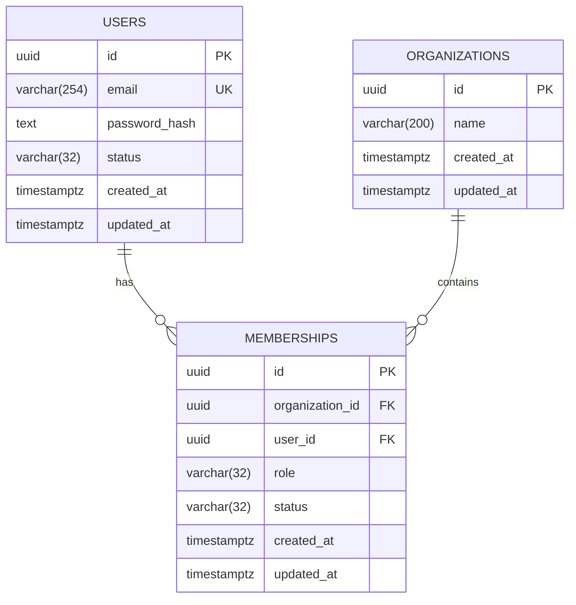

# Data and domain models

This is the model foundation for the generic multi-tenant authentication backend described in [the authentication design](authentication-authorization.md). A global user connects to organizations through memberships. Authentication also has a login session and the refresh tokens issued for that session.

Domain classes, JPA mappings, and the initial Flyway migration are defined for users, organizations, and memberships. `AuthSession` and `RefreshToken` currently have domain models only; their persistence mappings and tables are not implemented. Application services, repositories, HTTP endpoints, token generation/hashing/signing, and UUID generation are separate implementation steps.

## 1. Domain model versus data model

| Layer | Purpose | Examples |
| --- | --- | --- |
| Domain | Express valid state and state transitions | `User`, `AuthSession`, `RefreshToken`, `Organization`, `Membership`, `Role` |
| Persistence mapping | Translate domain state to database columns | `UserEntity`, `OrganizationEntity`, `MembershipEntity` |
| Database | Store records and enforce structural integrity | `users`, `organizations`, `memberships` |

Domain classes use no Spring or JPA annotations. They are immutable and use Lombok only to generate getters. An operation such as `rename` or `changeRole` returns a new object, which the application service must save.

Shared UUIDv7 and nonblank-string checks live in `common.Validation`. Its static methods return validated values, preserve field-specific error messages, and perform no normalization. The common package depends only on the JDK; domain-specific length limits and lifecycle rules stay with their models.

JPA classes have mutable persistence fields and protected no-argument constructors, as required by [Jakarta Persistence](https://jakarta.ee/specifications/persistence/3.2/apidocs/jakarta.persistence/jakarta/persistence/Entity.html). They map through `fromDomain(...)` and `toDomain()`; they are not HTTP response DTOs.



The diagram expresses database relationships. The service must create an organization and its first owner together; the foreign keys alone allow an organization with zero memberships.

## 2. Domain responsibilities

### User — global identity

`identity.domain.User` contains `id`, `email`, `passwordHash`, `UserStatus`, `createdAt`, and `updatedAt`.

- `User.create(id, email, passwordHash, now)` creates an active account.
- Email is stripped and lowercased using `Locale.ROOT`, preserving dots and `+` suffixes. The canonical value is limited to 254 Unicode code points.
- The password argument is already encoded. Hashing and email-format validation occur before model creation.
- `isActive()` distinguishes `ACTIVE` from `DISABLED`.
- Organization roles and membership lists are not part of this identity model.

### AuthSession — one login

`identity.domain.AuthSession` contains `id`, `userId`, `createdAt`, `lastSeenAt`, `absoluteExpiresAt`, and nullable `revokedAt`. This is an application-owned session for the JWT design, independent of servlet `HttpSession`.

| Operation | Behavior |
| --- | --- |
| `create(id, userId, now, absoluteExpiresAt)` | Creates an unrevoked session with creation and activity timestamps set to `now` |
| `isActiveAt(now, idleTimeout)` | Checks revocation, absolute expiration, and inactivity; requires a positive timeout |
| `recordActivity(now, idleTimeout)` | Returns new state with updated activity time only while the session is active |
| `revoke(now)` | Records revocation; repeated calls preserve the first revocation time |

All IDs must be UUIDv7. Absolute expiration must follow creation. Activity must be on or after creation and strictly before absolute expiration. Revocation cannot precede the last activity, but an already-expired session can still be revoked. State changes cannot move activity time backward, and an activity check before the recorded `lastSeenAt` fails closed.

Expiration takes effect exactly at either deadline: `now >= absoluteExpiresAt` or elapsed inactivity `>= idleTimeout`. Activity never extends the absolute deadline, and an expired or revoked session cannot be reactivated. Status is derived from timestamps rather than stored as an `EXPIRED` flag. Time and idle-timeout policy are supplied by the application; the model does not read the clock or configure durations.

### RefreshToken — a credential's persisted state

`identity.domain.RefreshToken` contains `id`, `sessionId`, `tokenHash`, `createdAt`, `expiresAt`, nullable `consumedAt`, and nullable `replacedByTokenId`.

| Operation | Behavior |
| --- | --- |
| `create(id, sessionId, tokenHash, now, expiresAt)` | Creates an unconsumed token record |
| `isConsumed()` | Identifies a previously used token, including after its expiration |
| `isUsableAt(now)` | Requires an unconsumed token and `createdAt <= now < expiresAt` |
| `consume(replacementTokenId, now)` | Returns consumed state linked to a replacement; rejects reuse and expiration |

IDs, including an optional replacement ID, must be UUIDv7. Expiration must follow creation. Consumption time and replacement ID must either both be present or both be absent. Consumption must occur on or after creation and strictly before expiration. A token cannot name itself as its replacement.

`tokenHash` uses the agreed SHA-256 digest encoded as exactly 64 lowercase hexadecimal characters (`TOKEN_HASH_LENGTH`). The constructor validates that representation; it neither computes the digest nor proves that the input came from a securely generated secret. Infrastructure generates and hashes the raw credential. The domain stores only the digest, and `toString()` omits it.

These checks concern one token record. Session/user checks, replacement membership in the same session, expiration bounded by the session's absolute deadline, and detection of a reused credential require application services. Consumption does not itself create a replacement or revoke a session.

### Organization — tenant

`tenancy.domain.Organization` contains `id`, `name`, `createdAt`, and `updatedAt`.

- `create(id, name, now)` creates the organization state.
- `rename(name, changedAt)` returns renamed state with the same ID and creation time.
- Names are stripped, cannot be blank, and are limited to 200 Unicode code points. Different organizations may use the same display name.
- Owner bootstrap and permission to rename require an application service transaction.

### Membership — user access within a tenant

`tenancy.domain.Membership` contains `id`, `organizationId`, `userId`, `Role`, `MembershipStatus`, `createdAt`, and `updatedAt`.

Roles are `OWNER`, `ADMIN`, and `MEMBER`. Status is `ACTIVE` or `REMOVED`.

| Operation | Behavior |
| --- | --- |
| `create(id, organizationId, userId, role, now)` | Creates active membership; `OWNER` is supported for organization bootstrap |
| `changeRole(role, changedAt)` | Changes an active membership's role; removed memberships cannot change role |
| `remove(changedAt)` | Marks membership removed; repeat removal returns existing removed state |
| `reactivate(role, changedAt)` | Restores removed membership with the explicitly assigned role; rejects an already-active membership |

Every transition preserves membership ID, organization ID, user ID, and creation time. Changes cannot move `updatedAt` backward. Rejoining updates the existing membership instead of inserting another row for the same user/organization pair.

These operations enforce local state rules. They do not establish the caller's permission: an application service must check tenant membership, the role matrix, target role restrictions, and the last-owner rule before invoking them.

All domain entities compare equality by ID. Comparing two objects with `equals` does not compare their current state. Their state transitions return immutable snapshots that the application must persist.

## 3. PostgreSQL data model

The schema is created by [V1__create_identity_and_tenancy_tables.sql](../src/main/resources/db/migration/V1__create_identity_and_tenancy_tables.sql), including the agreed field limits. It targets PostgreSQL 18+, matching the Compose image.

| Table | Important constraints |
| --- | --- |
| `users` | UUIDv7 primary key; unique canonical email; nonblank email/hash; valid account status; required timestamps in order |
| `organizations` | UUIDv7 primary key; trimmed nonblank name; required timestamps in order |
| `memberships` | UUIDv7 primary key; foreign keys to user and organization; unique `(organization_id, user_id)`; valid role/status; required timestamps in order |

All columns are required. Email uses `varchar(254)`, organization name uses `varchar(200)`, and password hashes use `text`. Roles and statuses use `varchar(32)` with their existing allowed-value check constraints. JPA stores enum names using `EnumType.STRING`, so Java ordinal positions are never persisted.

The email and name limits are application policies enforced after normalization in Java and by PostgreSQL column lengths. Java counts Unicode code points to match the database's character limits. The email length limit does not replace format validation or establish full SMTP/internationalized-email compliance.

Foreign keys use `ON DELETE RESTRICT`. Removing a membership changes its status, preserving the relationship row. The unique pair applies to active and removed memberships alike.

The unique organization/user index supports membership lookup within a tenant. An additional index starts with `user_id` for listing a user's organizations. A partial index covers active owner memberships; the owner check must also join the user's active status.

### IDs and timestamps

All IDs are UUIDv7, supplied to the domain constructors by the application. The JPA mappings deliberately use assigned IDs. There is no `UUID.randomUUID()` or automatic JPA UUID strategy.

PostgreSQL 18 provides `uuidv7()` and `uuid_extract_version()`. The migration uses `CHECK ((uuid_extract_version(id) = 7) IS TRUE)` so UUIDs of another variant, for which extraction returns null, are also rejected. UUID generation remains an infrastructure responsibility; it is not implemented by these models. [PostgreSQL UUID functions](https://www.postgresql.org/docs/18/functions-uuid.html)

Use Java `Instant` and PostgreSQL `timestamptz`. PostgreSQL stores instants with microsecond precision and renders them using the connection's time zone; it does not preserve the original zone name. Use UTC at application boundaries, and account for precision when comparing persisted timestamps. The explicit `createdAt` field remains the creation timestamp; do not substitute the UUID timestamp. [PostgreSQL timestamp types](https://www.postgresql.org/docs/18/datatype-datetime.html)

## 4. Module ownership and persistence mapping

```text
common/
  Validation.java

identity/
  domain/User.java
  domain/AuthSession.java
  domain/RefreshToken.java
  infrastructure/persistence/UserEntity.java

tenancy/
  domain/Organization.java
  domain/Membership.java
  domain/Role.java
  infrastructure/persistence/OrganizationEntity.java
  infrastructure/persistence/MembershipEntity.java
```

Identity owns users, login sessions, and refresh tokens; only `users` currently has a table and persistence mapping. Tenancy owns `organizations` and `memberships`. Relationships in the domain use UUID references: membership and session hold `userId`, and a refresh token holds `sessionId`. Membership has no JPA association to `UserEntity`. Tenant references also stay as IDs, avoiding implicit loading of entire object graphs. Database foreign keys still protect the persisted relationships in the monolith.

Each persistence class maps only its own domain class. Application services should depend on repository interfaces that return domain objects; persistence adapters will use the JPA mappings internally. Request and response DTOs are another boundary, especially because both user models contain a password hash.

## 5. Rules that require application services

The following cannot be guaranteed by a single domain object or ordinary row check constraint:

1. The caller is allowed to access the requested organization.
2. A target user is active before membership creation/reactivation.
3. An admin can add/remove ordinary members but cannot manage owners or other admins.
4. An organization always retains an active owner whose global user is also active.
5. Creating an organization also creates its first owner atomically.

PostgreSQL check constraints cannot safely enforce conditions depending on other rows. The last-owner rule needs a transaction that locks the organization row, reloads the actor and target, and checks active owners before writing. All membership mutations must follow that lock protocol. A future global account-disable operation must use compatible locks across affected organizations. [PostgreSQL constraint rules](https://www.postgresql.org/docs/18/ddl-constraints.html)

Every tenant query must include the requested organization ID, including lookups by membership ID and list/count queries. Foreign keys and UUIDs do not authorize a request. Row-level security is not configured by this migration.

For authentication, application services must validate the current user and session before accepting an access JWT or refreshing a token. The JWT's `sub` must match the session's `userId`. Token consumption and replacement insertion require one transaction with concurrency control. A replay response must commit any session revocation before reporting rejection; throwing an exception that rolls back that transaction would undo the revocation. Session activity updates must never overwrite a concurrent revocation or move `lastSeenAt` backward. These services and concurrency controls are not implemented by the domain classes.

## 6. Validation

New tests are deferred at the user's request. The following existing tests cover the original user and tenancy models, not `AuthSession` or `RefreshToken`. Run them without starting the Spring application:

```bash
./gradlew test --tests '*UserTest' --tests '*TenancyModelTest' --tests '*ModelMappingTest'
```

The mapping tests check Java conversions, including preservation of hashes, roles, removed status, tenant references, and timestamps. They do not start Hibernate or prove end-to-end repository behavior.

[model_constraints.sql](../src/test/resources/db/model_constraints.sql) checks the schema against a disposable PostgreSQL 18+ database. Apply V1 first in a transaction (for example, `psql -v ON_ERROR_STOP=1 --single-transaction -f V1__create_identity_and_tenancy_tables.sql`), then run the checks with `psql -v ON_ERROR_STOP=1`. It covers field-length boundaries, UUID versions/variants, uniqueness, foreign keys, invalid statuses, timestamp ordering, and reusing a removed membership. Its fixture transaction is rolled back.

Application-level authorization and transaction/concurrency integration tests will be needed when the service layer is implemented.
